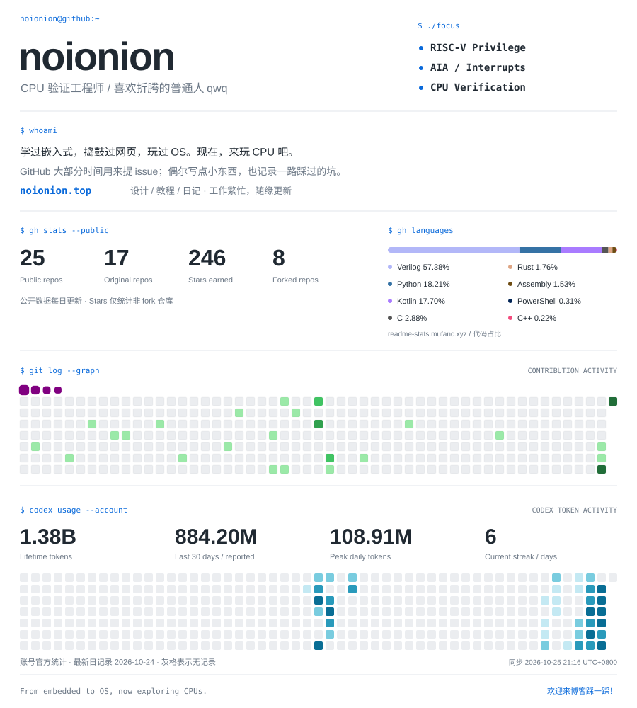

<picture>
  <source media="(prefers-color-scheme: dark)" srcset="assets/profile-dark.svg" />
  <source media="(prefers-color-scheme: light)" srcset="assets/profile-light.svg" />
  
</picture>

  <a href="https://noionion.top">博客 · 设计、教程与日记</a>
  &nbsp; / &nbsp;
  <a href="https://github.com/noionion?tab=repositories">我的仓库</a>
  &nbsp; / &nbsp;
  <a href="https://github.com/noionion/noionion/actions/workflows/snake.yml">每日更新</a>

关于我 / About me

- 这里是 noionion，一个 CPU 验证工程师 qwq。
- 从嵌入式、网页到操作系统，现在主要折腾 RISC-V Privilege 和 AIA。
- GitHub 大部分时间用来提 issue，也会放一些自己的小项目。
- [博客](https://noionion.top)记录设计、教程和日记；工作繁忙，暂时随缘更新。欢迎来踩一踩！

<!-- Layout inspired by https://github.com/mufanc/mufanc . -->
